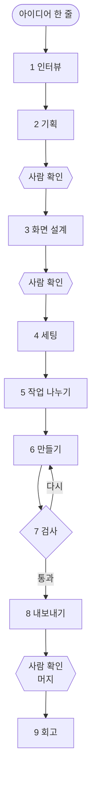

# bumpist-agents

아이디어 한 줄만 말하면, Claude Code가 정해진 순서대로 기획부터 미리보기 링크까지 만들어 줘요.

> 지금은 v0이에요. 1단계 인터뷰(`/bumpist:brief`)만 쓸 수 있어요.

## 왜 필요한가요

AI에게 "서비스 하나 만들어 줘"라고만 하면 이런 일이 생겨요.

- 무엇을 만들지 정하기도 전에 코드부터 써요.
- 할 때마다 순서가 달라서 결과도 들쭉날쭉해요.
- 대화가 끊기면 처음부터 다시 설명해야 해요.

bumpist-agents는 사람 팀처럼 순서를 지켜요. 단계마다 결과를 파일로 남겨서, 중간에 끊겨도 그 자리부터 이어 가요.

## 이렇게 진행돼요

1. **인터뷰**: 누가 쓰는지, 무엇이 성공인지 정해요.
2. **기획**: 기능의 우선순위와 데이터 초안을 잡아요.
3. **화면 설계**: 화면마다 쓸 부품을 골라요.
4. **세팅**: 저장소를 만들고 첫 미리보기를 띄워요.
5. **작업 나누기**: 만들 것을 작은 단위로 쪼개요.
6. **만들기**: 화면을 하나씩 만들어요.
7. **검사**: 규칙과 화면을 검사해요. 통과하지 못하면 6번으로 돌아가요.
8. **내보내기**: 미리보기 링크를 붙여 PR을 올려요.
9. **회고**: 다음 서비스를 위한 교훈을 남겨요.

2번 다음, 3번 다음, 그리고 8번에서 머지하기 전에는 사람이 확인하고 넘어가요. 지금은 1번만 되고, 2번부터 4번까지는 v0.1, 5번부터 9번까지는 v0.5에 들어와요.

<details>
<summary>같은 흐름을 그림으로 보기</summary>



</details>

## 써 보기

[Claude Code](https://claude.com/claude-code)가 있으면 바로 해 볼 수 있어요. 아래 명령은 터미널이 아니라 Claude Code 대화창에 입력해요.

1. 새 서비스용 빈 폴더를 만들고, 그 폴더에서 Claude Code를 열어요.
   다른 프로젝트 폴더에서 열면 그 프로젝트에 `.bumpist/` 폴더가 섞여요.
2. 플러그인을 설치해요.

   ```
   /plugin marketplace add parksubeom/bumpist-agents
   /plugin install bumpist@bumpist-agents
   ```

3. 인터뷰를 시작해요.

   ```
   /bumpist:brief
   ```

아이디어를 한 줄로 말하면 질문이 최대 다섯 개 와요. 답하면 `.bumpist/brief.md`가 생겨요. 모르는 질문에는 "모르겠어요"라고 해도 괜찮아요. 지어내지 않고, 나중에 확인할 가설로 적어 둬요.

## 이런 경우엔 안 맞아요

- Claude Code를 쓰지 않아요.
- Next.js가 아닌 프레임워크를 써요. 4단계 세팅이 Next.js 기준이에요.
- 사람 확인 없이 끝까지 자동으로 돌리고 싶어요.

## 더 알아보기

<details>
<summary>단계별 명령과 남기는 파일</summary>

모든 파일은 서비스 폴더의 `.bumpist/`에 모여요.

| 단계 | 명령 | 남기는 파일 | 나오는 버전 |
| --- | --- | --- | --- |
| 1 인터뷰 | `/bumpist:brief` | `brief.md` | 지금 |
| 2 기획 | `/bumpist:spec` | `prd.md`, `data-model.json` | v0.1 |
| 3 화면 설계 | `/bumpist:design` | `screens.json` | v0.1 |
| 4 세팅 | `/bumpist:scaffold` | 새 저장소 | v0.1 |
| 5 작업 나누기 | `/bumpist:plan` | `tasks.json` | v0.5 |
| 6 만들기 | `/bumpist:build` | 코드 | v0.5 |
| 7 검사 | `/bumpist:verify` | 검사 결과 | v0.5 |
| 8 내보내기 | `/bumpist:ship` | PR, `metrics.json` | v0.5 |
| 9 회고 | `/bumpist:retro` | 룰북 개선 제안 | v0.5 |
| 10 배움 | `/bumpist:learn` | 다음 `brief.md` 초안 | v1.1 |

</details>

<details>
<summary>다른 디자인 시스템과 함께 쓰기</summary>

기본은 [bumpist-design](https://github.com/parksubeom/bumpist-design)이에요. 부품 목록 형식(C2)만 맞추면 다른 디자인 시스템도 쓸 수 있어요.

</details>

<details>
<summary>다른 도구가 읽는 파일 형식</summary>

- C4 작업 기록: 진행 단계, 사람의 승인, 작업 목록 ([스키마](https://parksubeom.github.io/bumpist-agents/schemas/workspace/v0.json))
- C6 데이터·권한: 데이터 종류와 읽고 쓸 수 있는 사람 ([스키마](https://parksubeom.github.io/bumpist-agents/schemas/data/v0.json))

</details>

## Bumpist 저장소

하나만 골라 써도 되고, 함께 쓰면 서로 파일을 주고받아요.

| 저장소 | 하는 일 |
| --- | --- |
| [bumpist-design](https://github.com/parksubeom/bumpist-design) | 색만 바꾸면 되는 디자인 시스템 |
| **bumpist-agents (지금 보는 곳)** | 아이디어에서 미리보기까지 가는 작업 순서 |
| [bumpist-code](https://github.com/parksubeom/bumpist-code) | AI가 같은 방식으로 코드를 쓰게 하는 룰북 |
| [bumpist-ship](https://github.com/parksubeom/bumpist-ship) | 파일 하나로 붙이는 자동 검사 |
| [claude-distill](https://github.com/parksubeom/claude-distill) | Claude가 배운 것을 자동으로 기록 |

## 라이선스

MIT
