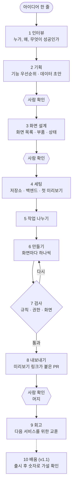
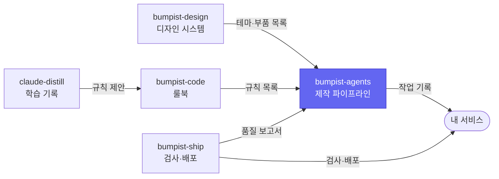

# bumpist-agents

**아이디어 한 줄에서 시작해, 정해진 단계를 차례로 밟아 미리보기 링크가 붙은 결과물까지 가는 Claude Code 작업 순서예요.**

AI에게 "서비스 하나 만들어줘"라고만 하면, 기획 없이 코드부터 쓰거나 매번 다른 순서로 일해요. 이 플러그인은 사람 회사가 일하는 순서를 그대로 따르게 해요. 인터뷰하고, 기획하고, 화면을 설계하고, 만들고, 검사하고, 내보내요. 단계마다 결과를 파일로 남기기 때문에 중간에 끊겨도 이어서 할 수 있어요.

> **지금 상태 — v0 (0단계).** 1단계 `/bumpist:brief`가 동작해요. 2\~4단계는 다음 단계(agents v0.1), 5\~9단계는 그다음(agents v0.5)에 들어와요.

## 어떤 문제를 푸나요

| 지금까지 | bumpist-agents를 쓰면 |
| --- | --- |
| AI가 무엇을 왜 만드는지 정하지 않고 코드부터 써요 | 먼저 누가 쓰는지, 무엇이 성공인지를 문서로 정하고 시작해요 |
| 매번 일하는 순서가 달라서 결과의 품질도 달라요 | 언제나 같은 단계를 같은 순서로 밟아요 |
| 대화가 끊기면 어디까지 했는지 처음부터 다시 설명해요 | 단계마다 결과가 파일로 남아서, 그 자리부터 이어서 해요 |
| 다 만들고 나서야 방향이 틀린 걸 알아요 | 중요한 갈림길 세 곳에서 사람이 확인하고 넘어가요 |

## 어떻게 동작하나요



| 단계 | 명령 | 하는 일 | 남기는 파일 | 상태 |
| --- | --- | --- | --- | --- |
| 1 인터뷰 | `/bumpist:brief` | 질문 다섯 개로 대상, 문제, 가설, 성공 기준, 하지 않을 일을 정해요 | `brief.md` | **지금 됨** |
| 2 기획 | `/bumpist:spec` | 기능의 우선순위와 데이터 구조 초안을 만들어요 | `prd.md`, `data-model.json` | v0.1 |
| 3 화면 설계 | `/bumpist:design` | 디자인 시스템의 부품 목록을 보고 화면마다 무엇을 쓸지 정해요 | `screens.json` | v0.1 |
| 4 세팅 | `/bumpist:scaffold` | 저장소, 로그인·데이터베이스, 자동 검사를 깔고 첫 미리보기를 띄워요 | 새 저장소 | v0.1 |
| 5 작업 나누기 | `/bumpist:plan` | 화면과 기능을 작업 단위로 쪼개고 순서를 정해요 | `tasks.json` | v0.5 |
| 6 만들기 | `/bumpist:build` | 화면마다 담당 에이전트가 하나씩 만들어요 | 코드 | v0.5 |
| 7 검사 | `/bumpist:verify` | 규칙, 데이터 권한, 실제 화면을 검사하고 문제가 있으면 6으로 돌려보내요 | 검사 결과 | v0.5 |
| 8 내보내기 | `/bumpist:ship` | 요약과 미리보기 링크를 붙여 PR을 올려요 | PR, `metrics.json` | v0.5 |
| 9 회고 | `/bumpist:retro` | 반복된 실수를 룰북 개선 제안으로 바꿔요 | 제안 초안 | v0.5 |
| 10 배움 | `/bumpist:learn` | 출시 뒤 숫자로 처음 세운 가설이 맞았는지 봐요 | 다음 `brief.md` 초안 | v1.1 |

모든 파일은 서비스 폴더 안의 `.bumpist/`에 모여요. 사람의 작업 일지 같은 폴더라서, 열어 보면 지금 어느 단계인지와 지금까지 무엇을 정했는지 알 수 있어요.

## 써 보기

[Claude Code](https://claude.com/claude-code)가 필요해요. 아래 세 줄은 터미널이 아니라 **Claude Code 대화창**에 입력해요.

1. **새 서비스용 빈 폴더**를 만들고, 그 폴더에서 Claude Code를 열어요. 다른 프로젝트 폴더 안에서 열면 그 프로젝트에 `.bumpist/`가 섞이니 꼭 새 폴더에서 시작하세요.
2. 플러그인을 설치해요.

   ```
   /plugin marketplace add parksubeom/bumpist-agents
   /plugin install bumpist@bumpist-agents
   ```

3. 인터뷰를 시작해요.

   ```
   /bumpist:brief
   ```

4. 아이디어를 한 줄로 말하면 질문이 최대 다섯 개 와요. 답하면 `.bumpist/brief.md`가 만들어지고, 승인할지 물어봐요.

   만들어지는 `brief.md`는 항상 이 순서예요.

   ```
   ## Target user        누가, 언제 쓰는가
   ## Problem            지금은 어떻게 하고, 무엇이 불편한가
   ## Hypotheses         확인할 가설 (H1, H2 …)
   ## Success metrics    가설마다 숫자 목표와 기간
   ## Out of scope       첫 버전에서 일부러 하지 않을 것
   ```

답을 모르는 질문은 "모르겠다"고 해도 돼요. 지어내지 않고 확인할 가설로 기록해요.

## 지금 되는 것과 아직 안 되는 것

| 시점 | 들어오는 것 |
| --- | --- |
| **지금 (v0)** | 플러그인 설치, 1단계 인터뷰, 작업 기록 형식(C4)과 데이터·권한 형식(C6) 정의 |
| agents v0.1 (2~6주차) | 2~4단계. 아이디어에서 로그인·데이터베이스가 붙은 저장소와 첫 미리보기까지 |
| agents v0.5 (7~12주차) | 5~9단계, 디자인 시스템에 없는 부품을 임시로 만드는 규칙 |
| v1.0 (13~16주차) | 고정된 예제 아이디어 5개로 매 릴리스마다 품질 점검 |
| v1.1 (17~22주차) | 10단계 배움 |

## 이런 경우엔 맞지 않아요

- **Claude Code를 쓰지 않는다면** 쓸 수 없어요. 이 플러그인은 Claude Code 안에서만 동작해요.
- **Next.js가 아닌 프레임워크**는 아직 지원하지 않아요. 4단계 세팅이 Next.js 기준이에요.
- **완전 자동을 원한다면** 기본 설정과 맞지 않아요. 기본은 세 곳에서 사람이 확인해요. 설정으로 줄일 수는 있지만 권하지 않아요.

## 다른 디자인 시스템과 함께 쓰기

기본은 [bumpist-design](https://github.com/parksubeom/bumpist-design)이지만, 부품 목록 형식(C2)을 맞춘 디자인 시스템이면 무엇이든 쓸 수 있어요. shadcn/ui 프로젝트에서 부품 목록을 자동으로 만드는 연결 도구도 계획에 있어요(시점 미정).

## 다른 도구가 읽는 파일 형식

| 형식 | 담는 것 | 정의 |
| --- | --- | --- |
| C4 작업 기록 | 진행 단계, 사람의 승인, 화면 설계, 작업 목록, 성과 기록 | [`schemas/workspace/v0.json`](https://parksubeom.github.io/bumpist-agents/schemas/workspace/v0.json) |
| C6 데이터·권한 | 서비스의 데이터 종류, 누가 무엇을 읽고 쓸 수 있는지 | [`schemas/data/v0.json`](https://parksubeom.github.io/bumpist-agents/schemas/data/v0.json) |

## Bumpist Suite 안에서

다섯 저장소는 서로의 코드를 가져다 쓰지 않고, 정해진 형식의 파일만 주고받아요. 그래서 하나만 골라 써도 되고, 모두 연결해 쓸 수도 있어요. 색칠된 칸이 이 저장소예요.

| 저장소 | 한 줄 설명 |
| --- | --- |
| [bumpist-design](https://github.com/parksubeom/bumpist-design) | 서비스마다 색만 바꾸면 되는 디자인 시스템 |
| [bumpist-agents](https://github.com/parksubeom/bumpist-agents) | 아이디어에서 미리보기 링크까지 가는 Claude Code 작업 순서 |
| [bumpist-code](https://github.com/parksubeom/bumpist-code) | AI가 매번 같은 방식으로 코드를 쓰게 하는 룰북 |
| [bumpist-ship](https://github.com/parksubeom/bumpist-ship) | 파일 하나로 붙이는 자동 검사·배포 |
| [claude-distill](https://github.com/parksubeom/claude-distill) | Claude가 대화에서 배운 것을 자동으로 기록 |



## 라이선스

MIT
